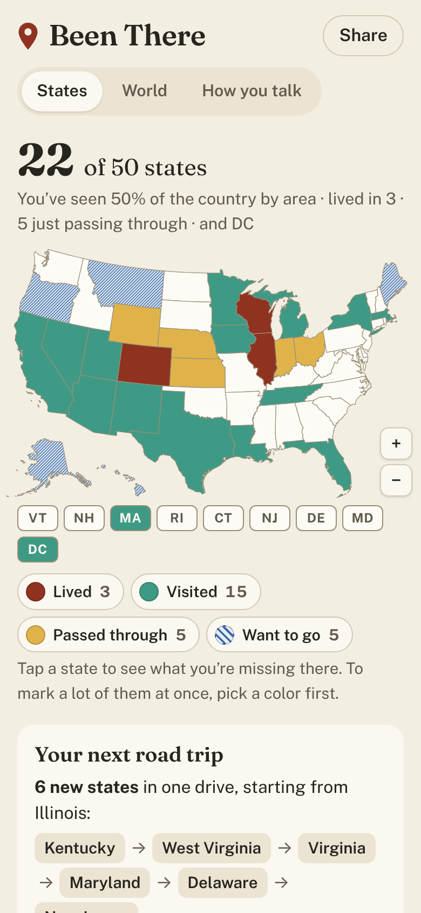
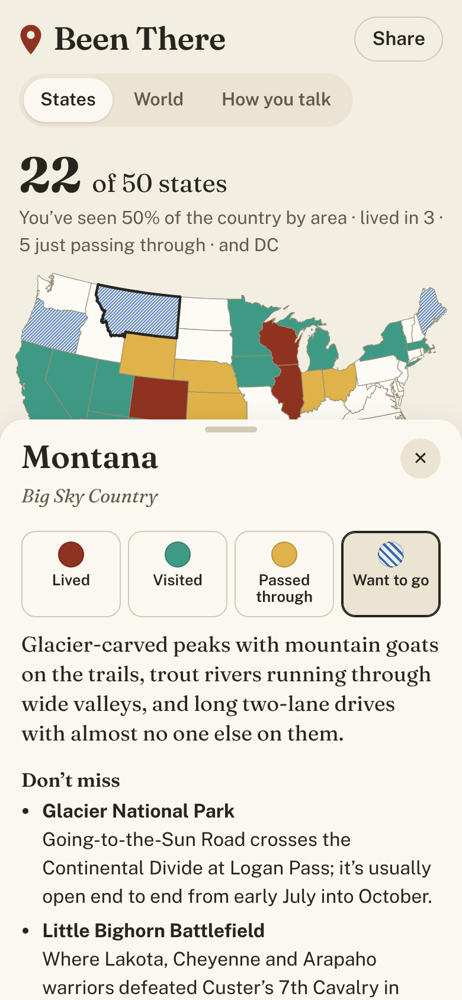
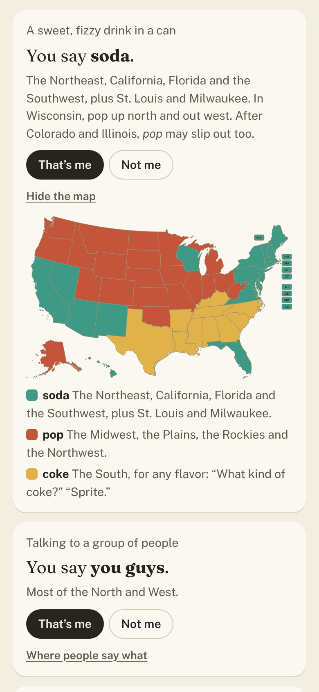

# Been There

**Use it: [been-there.junkdrawer.works](https://been-there.junkdrawer.works/)**

**A map of the states and countries you’ve been to, and what you’re missing in the rest.** Tap a state to mark it Lived, Visited, Passed through or Want to go, and its card opens: three things not to miss, a rough long weekend, an animal or plant to keep an eye out for, what to eat and one odd fact. A third page guesses how you talk (soda, pop or coke; bubbler; hoagie, hero or grinder) from where you grew up and where you’ve lived.

<p align="center">
  
  &nbsp;
  
  &nbsp;
  
</p>

## How it works

- **Tap to read, pick a color to mark.** Tapping a state or country opens its card, where you mark it. To mark a lot at once, pick a color in the key under the map first, then tap away. Pinch or use + and − to zoom; the small Northeast states have their own buttons.
- **What you’re missing.** Under the map: a road trip through touching states you haven’t been to that adds the most new ones, a handful of things you haven’t seen (a fresh set each day), your Want to go list with a plan for each, region-by-region progress, and milestones like Route 66, the Four Corners and every state on the Mississippi.
- **The world.** The same for 195 countries and the territories on the map, with a search box for the small ones, progress by continent, and how much of the world’s land you’ve set foot on.
- **How you talk.** About two dozen words and sounds, each guessed from where you grew up (counted three times) and anywhere else you’ve lived. Say yes or no, see a map of where people say what, and once you’ve answered five it works out where you sound like you’re from.
- **Share and compare.** Share makes a link that carries your map. Opening someone’s link shows their map, compares it with yours (both of you, only you, only them) and suggests a road trip for two. The link also moves your map to another phone, and you can save a picture of it.
- No account and no server. Your marks stay in your browser. It works offline and installs to a phone’s home screen.

## Running it

It’s a static site: plain HTML, CSS and JavaScript, with no build step.

```sh
npx serve .                   # or any static file server, then open the printed address
npm test                      # the arithmetic in Node, then the app in Chromium through the real page (needs Playwright)
node tools/screenshots.mjs    # redraws docs/*.png and og.png
node tools/make-icons.mjs     # redraws the PNG icons from icon.svg
npm install && npm run geo    # redraws the map shapes in js/data/*-geo.js
```

To put it online with GitHub Pages: **Settings → Pages → Build and deployment → Deploy from a branch**, then pick `main` and `/ (root)`.

### Files

- `js/app.js`: the page: the two maps, the cards, the lists, sharing and the word guesses on screen.
- `js/map.js`: a tappable, pinchable SVG map that colors its shapes by status.
- `js/logic.js`: the arithmetic with no page in it: counts, regions, milestones, the road trip search, word guesses, share links. `test/unit.test.mjs` checks it.
- `js/picture.js`: draws your map as a picture to save or send.
- `js/data/states.js`, `js/data/countries.js`: what each card says. Plain data, easy to edit.
- `js/data/words.js`: each word, its answers, which states use which, and the splits inside states.
- `js/data/us-geo.js`, `js/data/world-geo.js`: the shapes, made by `tools/build-geo.mjs` from [us-atlas](https://github.com/topojson/us-atlas) (US Census Bureau) and [world-atlas](https://github.com/topojson/world-atlas) (Natural Earth), both public domain. The world is drawn in the Equal Earth projection, so areas compare fairly.
- `fonts/`: Fraunces and Public Sans (SIL Open Font License), served from here so nothing loads from elsewhere.
- `sw.js`: keeps a copy for using offline, and opens from it when the connection isn’t answering. `FILES` in it is a fingerprint of the files it keeps: change one and `npm test` says what to set it to, so a release never leaves the copy half old.
